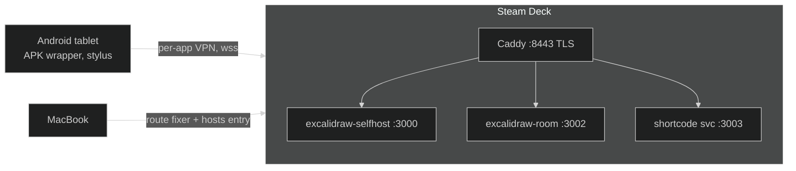

# Excalidraw self-hosted: Steam Deck + Android tablet + MacBook

Self-hosted collaborative whiteboard. **Excalidraw (app + collab room) runs on a
Steam Deck** under podman; all devices reach it over the tailnet via HTTPS
(Tailscale-issued cert). Room sharing supports a **short code** (e.g. `7QU6-38SK`)
in addition to the full link; the Join-room UI and all new strings ship inside the
[forked Excalidraw build](https://github.com/knocking4thcylinder/excalidraw-selfhosted-fork).

Draw with a stylus on the Android tablet, mirrored live on any device in the tailnet.



## Layout of this repo

| Path                        | Purpose                                                                                                                                                                                      |
| --------------------------- | -------------------------------------------------------------------------------------------------------------------------------------------------------------------------------------------- |
| `install.sh`                | **Deck**: full canonical installer — storage (vfs on `/home`), Tailscale cert, Caddy TLS `:8443`, app + room + short-code services, systemd units, verification. Idempotent; safe to re-run. |
| `Caddyfile.template`        | Shared HTTPS routes rendered by both installation and full redeployment; edit this rather than the generated `Caddyfile`. |
| `backend/`                  | Elixir/SQLite API on `:3003`: short codes, room registry, folders, encrypted scene snapshots (database in `~/excalidraw/shortcode-data/whiteboard.sqlite3` — **contains room keys**). See `backend/README.md`. |
| `tools/restore-room.js`     | admin CLI: re-encrypt a local `.excalidraw` export and upload it as a room's current snapshot                                                                                            |
| `mac/install-mac.sh`        | Mac: installs the LaunchDaemon route fixer + `/etc/hosts` entry (interactive prompt for the Deck FQDN / tailnet IP)                                                                          |
| `mac/fix_ts_routes.sh`      | asserts a `/32` route per tailnet peer every 20 s (beats proxy/TUN apps like Happ)                                                                                                           |
| `mac/com.fixtsroutes.plist` | LaunchDaemon definition (`user.fixtsroutes`)                                                                                                                                                 |
| `android/build.sh`          | reproducible APK build: fetches Google `cmdline-tools` on first run, compiles with `aapt2`/`javac`/`d8`, signs with a locally generated keystore                                             |
| `android/app/...`           | fullscreen WebView (minSdk 21 — HarmonyOS 2.0 works), INTERNET only, keeps screen on, VIEW-intent for room links, remembers last URL                                                         |

## URLs

| From                    | URL                                                                                                      |
| ----------------------- | -------------------------------------------------------------------------------------------------------- |
| Anywhere on the tailnet | `https://steamdeck.example.ts.net:8443`                                                               |
| Room share              | full link _or_ short code — created via **Live Collaboration → Start session**, code shown in the dialog |

## Setup, one command per device

```bash
# Deck (once: sudo steamos-readonly disable)
./install.sh

# Mac (needs sudo)
sudo ./mac/install-mac.sh

# Android
cd android && ./build.sh
adb install -r build/Excalidraw.apk
```

Wireless adb, if you want a cable-free tablet: plug USB once → `adb tcpip 5555` →
`adb connect <tablet-tailnet-ip>:5555` → unplug forever (works over the tailnet).

## Reproduction notes (things that cost us hours — don't re-learn them)

- **SteamOS `/var` is a 230 MB partition** — podman's root store must live on `/home`;
  the `overlay` driver fails on `/home`'s FS here → installer sets **vfs** on
  `/home/containers/storage` and frees the old `/var/lib/containers` store
- **`crypto.subtle` needs a secure origin** — plain-IP `http://` silently breaks
  "Start session" (no exception surfaces); hence HTTPS everywhere
- **Excalidraw's collab URL is baked into the built JS bundle** — the installer
  patches it to `wss://<fqdn>:8443` and verifies by grepping for _zero_ remaining
  `oss-collab.excalidraw.com` references before starting nginx
- **Offline app shell**: the source build enables Workbox/PWA precaching, with
  runtime caches for fonts, locales and lazy chunks. A browser must load/cache
  those resources before it can launch offline; room-data caching alone does
  not make a first-ever visit work without the server
- **Caddy path matchers**: `/api/code/*` does not match a bare `/api/code` request —
  hence the `*` without slash in this repo's Caddyfile
- **Single-file bind mounts**: `sed -i` inside the Caddy container fails with
  "Resource busy" (temp-file rename); edit the host file and restart the container
- **proxy/TUN apps on the Mac (Happ etc.)** hijack `100.64/10` and DNS — the
  per-peer `/32` route daemon + hosts entry neutralize both
- Rooms are E2E-encrypted; the short-code map trades a bit of that
  (it stores room keys server-side) for shorter links — delete
  short codes from the SQLite database to revoke them: stop
  `excalidraw-shortcode`, then run
  `sqlite3 shortcode-data/whiteboard.sqlite3 "DELETE FROM records WHERE kind = 'codes'"`

## Repo layout (monorepo)

This repo is the whole project: packaging (`install.sh`, `backend/`, `tools/`,
`mac/`, `android/`) plus the app source under `app/` (the former
`excalidraw-selfhosted-fork`, merged as a git subtree with full history —
see `git log -- app`). `~/excalidraw` on the Deck IS this repo's checkout
(branch `master`); runtime files (`shortcode-data/`, `certs/`, `Caddyfile`)
live next to it, gitignored, never committed.

Pulling upstream Excalidraw into `app/` later:

```bash
git subtree pull --prefix=app https://github.com/excalidraw/excalidraw.git <tag-or-main> --squash
```

(`--squash` keeps upstream history out of our log; drop it to keep full
history. The old `excalidraw-selfhosted-fork` remote is frozen/archive.)

## Updating the app on the Deck

Commit under `app/` (or packaging), push `master`, then on the Deck:

```bash
cd ~/excalidraw && ./deploy.sh   # git pull (when a checkout) + rebuild + swap + HTTPS checks
```

No bundles: the Deck updates via `git pull` (needs one read credential for
this private repo), falling back to files synced from the Mac.

For smaller updates, deploy only the affected component:

```bash
./deploy.sh app       # build/swap frontend only; leave backend and proxy running
./deploy.sh backend   # rebuild/swap the Elixir API; no frontend build
./deploy.sh full      # default: frontend + shortcode backend + proxy routes
./deploy.sh app --local  # deploy working-tree files without git pull
```

Selective modes still pull the whole checkout unless `--local` is passed, but
only deploy the selected component. Use `full` for changes spanning components
or proxy routes. `backend` updates the shortcode/rooms API, not the external
`excalidraw-room` collaboration image. The API backend is the Elixir/SQLite
service in `backend/`; the former Node service has been retired. On a Deck
still running Node, the first backend deployment imports its JSON files into
SQLite once and restores the old container if the health checks fail. See
`backend/README.md` for preview, JSON import, backups, and recovery.
Each deployment prints stage timings, including dependency and frontend builds.
On Podman's `vfs` driver, builds automatically use a reusable, pinned Node
container with a host-mounted `.build-cache/` workspace. Source files are synced
without touching the checkout's dependencies or build output. Dependencies
persist between builds; only the small nginx runtime image is rebuilt. The
builder stops after each build and restarts on demand. This path requires rsync,
but does not require Node or Yarn on the host.

Other storage drivers retain the multi-stage container build. Override selection
with `DEPLOY_BUILD_MODE=fast` or `DEPLOY_BUILD_MODE=container`. Both paths key
dependency caching by the lockfile, workspace manifests, and pinned Node image;
the first build populates the cache, and source-only changes skip installation.
The container path retains dependencies under the `excalidraw-build-deps` image
tag. Workspace additions must also be listed in the Dockerfile's manifest stage
(`node --test deploy.test.js` checks this).
To validate a build without changing the deployment image tag, run
`DEPLOY_IMAGE_TAG=excalidraw-verify ./deploy.sh build`; no live containers are swapped.

Image cleanup is no longer part of each deployment. The next deployment (or
`./deploy.sh start`) installs the weekly cleanup timer. To clean up immediately,
run `./deploy.sh cleanup` manually.
Cleanup preserves tagged images (including dependencies) and refuses to run
during a deployment/build. Fast builds require 6 GiB of free space; multi-stage
builds require 12 GiB. Both the workspace and Podman storage filesystems are
checked. Override the threshold with `DEPLOY_MIN_FREE_KB` (KiB)
only when sufficient space is available for your storage driver.

## Server recovery and diagnostics

The whole stack is managed by a boot-enabled systemd service:

```bash
sudo systemctl status excalidraw-stack
sudo systemctl restart excalidraw-stack  # restart all four containers
sudo systemctl stop excalidraw-stack     # stop all four containers
sudo systemctl start excalidraw-stack
sudo systemctl start --no-block excalidraw-deploy  # build and deploy in the background
sudo systemctl status excalidraw-deploy           # deployment result and recent logs
```

The stack service is a coordinator (`active (exited)` is normal); each component
has its own continuously supervised service. Deployment is on-demand only,
not run on every boot. In a synced directory without `.git`, it builds local files.

```bash
./deploy.sh start   # restore boot services and start existing containers; no rebuild
./deploy.sh status  # container/service state and verified HTTPS app, room, API checks
./deploy.sh logs    # recent logs for all four services
```

Always use `https://steamdeck.example.ts.net:8443` on the tablet with
Tailscale connected. Port 443 may serve another application. If the app works
locally but the tablet cannot connect, check the HTTPS proxy with `status`;
`start` repairs missing systemd units, including the Caddy unit, so the stack
starts after reboot. It also renews the TLS certificate when it has less than
seven days remaining, and installs a daily certificate-renewal timer.

Legacy `deck-redeploy-fork.sh`, `redeploy-fork.sh`, and `run-https.sh` commands
now forward to the same deployment helper instead of maintaining separate,
outdated container configurations. `./deploy.sh build` builds only the app image.

A synced directory without `.git` does **not** download GitHub updates: deploying
builds its local files and prints a warning. Use a real checkout of
`knocking4thcylinder/excalidraw-selfhosted` for automatic `git pull` updates.
Deployment preserves `shortcode-data/` and prevents concurrent deployments.

### Room folders

**My rooms** displays an editor-style file tree, with expandable folders and
rooms nested beneath them. Click a folder to expand or collapse it; click a
room to open its drawing. Rooms without a folder appear at the root.
The explorer is a **Rooms Explorer** tab in Excalidraw's existing right sidebar,
alongside the library and canvas search. The existing top-right sidebar button
or **My rooms** opens it. The native pin and close buttons control docking and
visibility; there is no separate rail or half-screen panel. Compact tree rows,
icon-only actions, indentation guides, and right-click menus follow an editor
Explorer layout. **Expand all** and **Collapse all** control the whole tree.
Opening or creating a room keeps the explorer open.
The room list appears independently of folder loading and stays visible during
background refreshes. The app warms the room list in the background and retains
it across sidebar closes, so reopening the explorer does not wait for a request.
Room lists and folder metadata persist in IndexedDB and appear while fresh
network requests run. Failed refreshes retain the available local metadata.
Up to 32 confirmed drawings persist by room and key, including their ETags.
Reopening a cached room displays the local drawing without waiting for server
validation; **Checking for updates…** remains visible until validation completes.
Cached room switches also restore the scene and cached images before the
collaboration client finishes loading; connection setup runs in the background.
The server validates the encrypted snapshot fingerprint and sends no drawing
payload when it is unchanged, even after a browser restart.
Edits made while validation runs are saved as separate room/key-scoped recovery
drafts. They merge with the validated snapshot before broadcasting or saving;
unchanged cached shapes removed from the server snapshot are not resurrected.
Failed validation preserves local work and resumes the existing reconnect flow.
Room switches ignore old responses; deleting a room clears its per-room cache
and prevents a closing session's delayed draft write from recreating it.
Drafts are not evicted with the confirmed-scene cache. Browser storage can still
fail or be cleared/evicted: export important drawings as backups. Cached drawings
are stored locally as decoded data, alongside room keys, like the existing canvas
recovery storage. This is not an encrypted-at-rest vault.
Room images also persist by room, key and file ID. Previously cached images
appear without downloading again, and mixed requests download only missing
files. Local images are cached before upload and alongside recovery drafts,
so failed uploads do not discard the available local image data. Cached local
images are not treated as proof of a successful remote upload. Deleting a room
also deletes its cached images and blocks late attachment writes.
Attachments remain until their room is explicitly deleted (even if its
confirmed snapshot is evicted), to preserve recovery drafts; large image
libraries can consume browser storage. Cache failures fall back to downloads.
Local caching works with any API configuration. Uncached
images/fonts/features may still need the network.
The Elixir backend additionally supports opt-in encrypted partial updates:
`SCENE_SYNC_ENABLED=true ./deploy.sh backend --local`.
Update the app and refresh clients before enabling it. Small edits upload only
changed shapes, removed IDs, and ordering when needed; cached-room downloads
request only patches since the confirmed ETag. Revision checks prevent stale
writers from overwriting concurrent saves, and periodic full checkpoints bound
the patch chain. Deployments without the flag retain full snapshots.
Old clients cannot read active patch chains and are rejected safely. See
`backend/README.md` for protocol limits.
See `docs/loading-benchmark.md` for isolated loading measurements, limitations,
and instructions for reproducing cold-data, cached, and partial-update runs.
Downloads time out after 20 seconds without receiving data, rather than after
20 seconds total, so a slow but progressing transfer can finish. Empty-save
protection checks snapshot existence with a body-free HEAD request instead of
repeatedly downloading the entire drawing.
Room joins merge saved snapshots with live peer updates;
failed snapshot downloads show a connection error instead of being treated as
empty rooms, and incomplete joins cannot save a partial scene over the snapshot.
Deleting a room opens an explicit confirmation naming the room; confirm to
remove it, or cancel to keep it. Deleting the current room disconnects its
session but keeps the drawing on the local canvas.
Search finds rooms and folder paths across the entire tree, automatically
revealing matching branches without changing your saved expansion state.
Folders can be nested: select a folder and use **New folder** to create a
subfolder. Deselect the folder with the tree heading to create at the root.
Creation and F2 rename use an inline name field in the tree: Enter saves,
Escape cancels, and leaving a nonempty field saves it. No parent selector or
separate save form is shown. A folder cannot be moved into itself or a descendant.
Names must be unique
within the same parent, but may be reused in different branches.

Drag rooms or folders onto another folder to move them. While dragging, the
**Top level** target moves items back to the root. On tablets, the room's move
menu provides room moves without dragging. Destination menus show full paths.
Use Up/Down, Left/Right, Home/End, and Enter to navigate the tree with a keyboard.
Press F2 to rename a focused room or folder.
Click the tree's heading to deselect a folder before creating a root folder.
Select a folder to rename, move, or delete it. Deleting a folder also removes
its subfolders, but keeps all their rooms and drawings, moving them to **Unfiled**.

Folders are shared across clients of this self-hosted instance, like the room
registry, and persist in `shortcode-data/folders.json`. The service supports a
`FOLDERS_FILE` override; by default it stores folders alongside `ROOMS_FILE`.
Deploy both the app and shortcode service to enable folder management.
