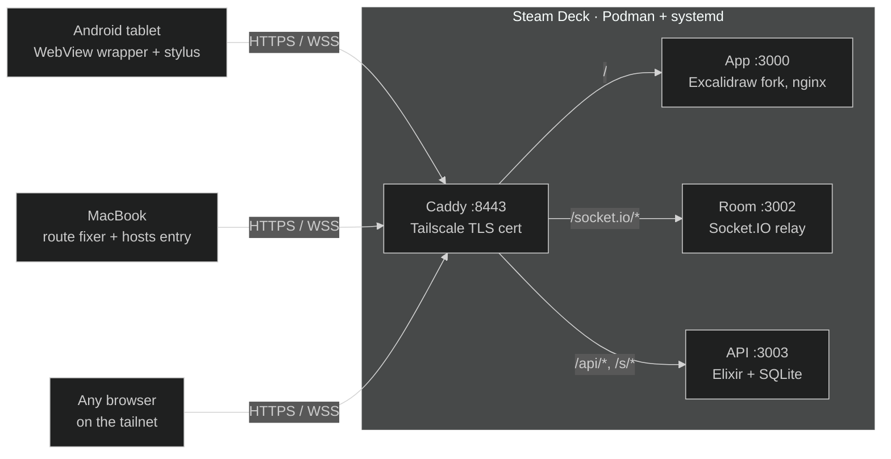

<div align="center">

# Excalidraw, self-hosted on a Steam Deck

**A private, real-time collaborative whiteboard that runs on a handheld and is reachable from every device on your tailnet.**

Draw with a stylus on an Android tablet and watch it appear live on a laptop. Every room is kept on a server you own.


</div>

---

## Highlights

- **Live collaboration with no third-party services.** The Excalidraw app, its
  Socket.IO room server, and the persistence API all run on the Deck, and
  Firebase has been removed.
- **Short room codes.** Share `7QU6-38SK` instead of a 60-character link. The
  Join-room panel accepts either one.
- **Rooms Explorer.** A file-tree sidebar for every room on the server, with
  nested folders, drag-and-drop, search, and keyboard navigation.
- **Offline-first rooms.** Cached drawings open instantly, edits made offline
  are kept as per-room drafts, and they're merged back when you reconnect.
- **Versioned snapshots.** Encrypted scenes are stored in SQLite with the last
  ten versions kept, and an empty canvas can never overwrite a real drawing.
- **Opt-in incremental sync.** When enabled, small edits upload only the
  shapes that changed, not the whole scene.
- **A client for each device.** There's a no-Gradle Android WebView wrapper
  for the tablet and a route-fixer daemon that keeps the Mac on the tailnet
  when a VPN or proxy app interferes.
- **One-command deploys.** `./deploy.sh` rebuilds, swaps the containers, runs
  HTTPS health checks, and rolls back the API if those checks fail.

## How it works



| Component | What it does |
| --- | --- |
| **Caddy** | Terminates TLS with a certificate from `tailscale cert` and routes each path to a service |
| **App** | The Excalidraw fork in [`app/`](app/), built into an nginx image with a PWA shell for offline use |
| **Room** | The upstream `excalidraw-room` relay, which carries live edits between clients over one WebSocket each |
| **API** | The Elixir service in [`backend/`](backend/) that stores short codes, the room registry, folders, encrypted snapshots, and images |

Every component is a container supervised by its own systemd unit, under a
coordinating `excalidraw-stack` service, so the stack comes back after a
reboot.

## Quick start

**Prerequisites:** Tailscale with MagicDNS enabled on every device, plus Podman
and systemd on the host.

```bash
# Steam Deck (one time: sudo steamos-readonly disable)
git clone https://github.com/knocking4thcylinder/excalidraw-selfhosted.git ~/excalidraw
cd ~/excalidraw && ./install.sh
```

The installer is idempotent. It moves Podman storage off SteamOS's tiny `/var`,
gets a TLS certificate, builds the images, installs the systemd units, and
verifies the result. Then open `https://<deck-magicdns-name>:8443` from any
device on your tailnet.

<details>
<summary><b>MacBook</b>: keep the tailnet reachable when VPN or proxy apps are running</summary>

```bash
sudo ./mac/install-mac.sh
```

This installs a LaunchDaemon that pins a `/32` route to every tailnet peer every
20 seconds, and adds an `/etc/hosts` entry for the Deck. You only need it if a
TUN-mode app (Happ, Xray, …) takes over `100.64.0.0/10` or DNS.

</details>

<details>
<summary><b>Android tablet</b>: build and install the fullscreen wrapper</summary>

```bash
cd android && APP_HOST=<deck-magicdns-name> ./build.sh
adb install -r build/Excalidraw.apk
```

`build.sh` needs no Gradle and runs on macOS or Linux. On its first run it downloads Google's
`cmdline-tools`, then compiles with `aapt2`/`javac`/`d8` and signs the APK with
a locally generated keystore. The app is pinned to the `APP_HOST` origin, which
is remembered for later builds. The APK supports minSdk 21, so HarmonyOS 2.0
works. It's a domain-pinned WebView that keeps the screen on, opens room links,
and saves exports to `Downloads/`.

To connect over Wi-Fi: plug in USB once, run `adb tcpip 5555`, then
`adb connect <tablet-tailnet-ip>:5555`.

</details>

## Usage

1. Open the app and choose **Live Collaboration → Start session**.
2. Copy the **short code** or the full link from the dialog.
3. On another device, open **Join room** and paste either one.
4. Find all your rooms later under **My rooms** in the right sidebar.

[docs/rooms.md](docs/rooms.md) covers folders, caching, drafts, and sync in
detail.

## Deploying changes

```bash
./deploy.sh              # pull, rebuild everything, swap containers, check HTTPS
./deploy.sh app          # frontend only
./deploy.sh backend      # Elixir API only
./deploy.sh app --local  # deploy the working tree without git pull
./deploy.sh status       # container and service state, plus live health checks
./deploy.sh logs         # recent logs from all four services
```

[docs/operations.md](docs/operations.md) covers build caching, disk-space
guards, certificate renewal, recovery, and pulling from upstream Excalidraw.

## Repository layout

```
.
├── app/                  Excalidraw fork (git subtree of upstream, full history)
├── backend/              Elixir/SQLite API: rooms, folders, codes, snapshots, images
├── android/              no-Gradle APK build + WebView wrapper
├── mac/                  route-fixer LaunchDaemon + installer
├── tools/restore-room.js re-encrypt a local .excalidraw export into a room
├── install.sh            first-time host installer (idempotent)
├── deploy.sh             build / deploy / status / logs / cleanup
├── Caddyfile.template    HTTPS routes (edit this, not the generated Caddyfile)
└── docs/                 rooms, operations, loading benchmark
```

## Development

```bash
# Frontend
cd app && yarn && yarn start
yarn test:typecheck && yarn test:app --watch=false

# Backend (Elixir 1.18+ / OTP 27)
cd backend && mix deps.get && mix test

# Deploy scripts
node --test deploy.test.js
```

## Security model

> [!WARNING]
> **Rooms are not end-to-end encrypted against this server.** Scenes and images
> are encrypted with each room's key, but the API also stores every room key,
> and `GET /api/rooms` returns them so that any device can open any room. Anyone
> who can reach the API can read every room. **Your tailnet is the only access
> control.** Don't expose port 8443 outside it.

The SQLite database (`shortcode-data/whiteboard.sqlite3`) contains the room
keys, so treat its backups as sensitive. Deleting a room also deletes its short
codes and images.

## Documentation

| Document | Contents |
| --- | --- |
| [docs/rooms.md](docs/rooms.md) | Rooms Explorer, offline caching, drafts, images, incremental sync |
| [docs/operations.md](docs/operations.md) | Deploy modes, build caching, systemd, recovery, lessons learned |
| [backend/README.md](backend/README.md) | API reference, scene-sync protocol, backups, safe preview |
| [docs/loading-benchmark.md](docs/loading-benchmark.md) | Isolated loading and Android rendering benchmarks |
| [PROJECT.md](PROJECT.md) | Full project history and handoff notes |

## License

[MIT](LICENSE). Built on [Excalidraw](https://github.com/excalidraw/excalidraw)
and [excalidraw-room](https://github.com/excalidraw/excalidraw-room); the app
source in `app/` keeps upstream's [MIT license](app/LICENSE).
