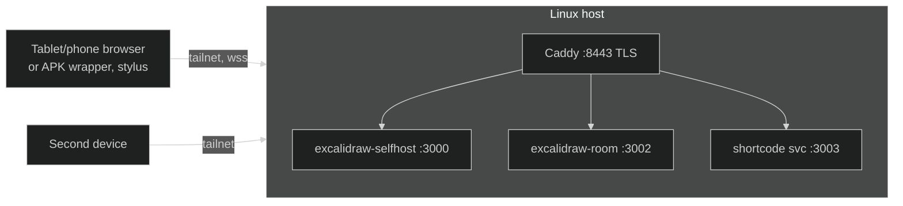

# Excalidraw self-hosted (generic Linux)

Self-hosted collaborative whiteboard. The Excalidraw web app plus its collab
room server run in **podman containers on a generic Linux host**; all devices
reach it over the tailnet via HTTPS (Tailscale-issued cert). Room sharing
supports a **short code** (e.g. `7QU6-38SK`) in addition to the full link; the
Join-room UI and all new strings ship inside the forked Excalidraw build
under `app/`.



## Layout of this repo

| Path | Purpose |
|---|---|
| `install.sh` | Full canonical installer on the host: container storage setup, Tailscale cert, Caddy TLS `:8443`, app + room + short-code services, systemd units, verification. Idempotent; safe to re-run. |
| `redeploy.sh` | Fast path after `app/` or packaging changes: `git pull` + rebuild + container swap (run on the host from `~/excalidraw`) |
| `shortcode/server.js` | Tiny HTTP service minting/joining short codes (map persisted in `~/excalidraw/shortcode-data/codes.json` — **contains room keys**, deleting it revokes all codes) |
| `app/` | Forked Excalidraw source (git subtree, full history — `git log -- app`), built into the `excalidraw-selfhost` image on the host |
| `mac/` | Optional: Mac client route fixer (LaunchDaemon + `/etc/hosts`) for tailnets reached through proxy/TUN apps |
| `android/` | Optional: reproducible no-gradle APK build (fullscreen WebView wrapper, minSdk 21), VIEW-intent for room links |

## URLs

| From | URL |
|---|---|
| Anywhere on the tailnet | `https://<your-host-magicdns>:8443` |
| Room share | full link *or* short code — created via **Live Collaboration → Start session**, code shown in the dialog |

## Setup

Prereqs on the host: `podman`, `tailscale` (logged in, MagicDNS enabled),
`git` (`python3` for automatic FQDN detection, otherwise export `FQDN`).

```bash
# on the host, from a checkout of this repo (e.g. ~/excalidraw):
./install.sh

# after app/packaging changes (on the host):
bash ~/excalidraw/redeploy.sh
```

Optional clients:

```bash
# Mac route fixes (needs sudo)
sudo ./mac/install-mac.sh

# Android APK
cd android && ./build.sh
adb install -r build/Excalidraw.apk
```

Wireless adb, if you want a cable-free tablet: plug USB once → `adb tcpip 5555` →
`adb connect <tablet-tailnet-ip>:5555` → unplug forever (works over the tailnet).

## Reproduction notes (things that cost us hours — don't re-learn them)

- **`crypto.subtle` needs a secure origin** — plain-IP `http://` silently breaks
  "Start session" (no exception surfaces); hence HTTPS everywhere
- **Excalidraw's collab URL is baked into the built JS bundle** — the installer
  patches it to `wss://<fqdn>:8443` and verifies by grepping for *zero* remaining
  `oss-collab.excalidraw.com` references before starting nginx
- **Service worker removed in the fork** (Workbox/PWA plugin disabled): redeploys
  now reach clients as plain network loads — no unregister/hard-reload dance.
  Trade-off: no offline cached app shell — acceptable for tailnet use.
  `index.html` is served `no-store`, hashed assets `immutable`
- **Caddy path matchers**: `/api/code/*` does not match a bare `/api/code` request —
  hence the `*` without slash in the Caddyfile
- **Single-file bind mounts**: `sed -i` inside the Caddy container fails with
  "Resource busy" (temp-file rename); edit the host file and restart the container
- **Run duplicate-free**: two container runtimes (e.g. root + rootless podman)
  share host networking — a second `excalidraw-room` will steal `:3002` and
  crash-loop the canonical one. Always use the same podman (this repo: `sudo podman`)
- Rooms are E2E-encrypted; the short-code map trades a bit of that
  (it stores room keys server-side) for shorter links — delete
  `shortcode-data/codes.json` at any time to revoke

## Offline use (tablet without network)

The app shell is precached by a service worker, so rooms open with no
network. Draw freely — work persists on the device. Offline is silent: no
banner, no prompts; the client rejoins in the background (poll + socket
events, not just `navigator.onLine`) and merges offline strokes with the
server snapshot (union, versioned), then saves back; history keeps prior
snapshots, and empty states never overwrite good ones (409 + client guards).
Rooms created offline register themselves on first connect. Every edit also
lands in a room-scoped device backup, and server snapshots save every ~5s,
so a crash loses seconds at most. Collab itself needs connectivity; offline
means solo drawing with later merge (last-writer-wins per element on
conflict).

## Updating the app

Commit under `app/` (or packaging), push `master`, then on the host:

```bash
cd ~/excalidraw && bash redeploy.sh   # git pull + rebuild + swap
```

No bundles: the host updates via `git pull` (needs one read credential for
this private repo), falling back to files synced from another machine.

## Platform quirks

- **SteamOS**: `/var` is a ~230 MB partition, so the installer moves podman's
  root store to `/home/containers/storage` with the `vfs` driver (overlay fails
  on that FS); needs `sudo steamos-readonly disable` once. Use
  `reinstall.sh` (re-runs `install.sh`) after SteamOS updates.
- **Small `/var` on other distros**: if under ~2 GB free and no
  `storage.conf` exists yet, the installer moves just the graphroot to
  `/home/containers/storage`, keeping the default driver.
