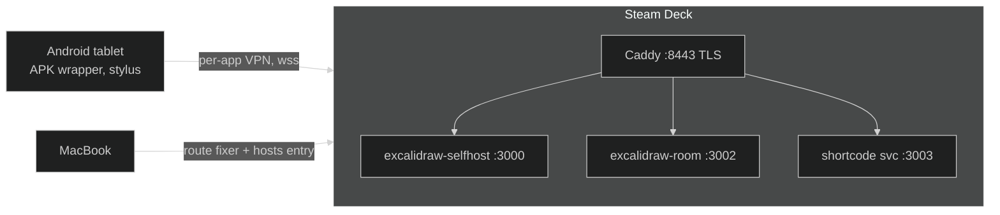

# Excalidraw self-hosted: Steam Deck + Android tablet + MacBook

Self-hosted collaborative whiteboard. **Excalidraw (app + collab room) runs on a
Steam Deck** under podman; all devices reach it over the tailnet via HTTPS
(Tailscale-issued cert). Room sharing supports a **short code** (e.g. `7QU6-38SK`)
in addition to the full link; the Join-room UI and all new strings ship inside the
[forked Excalidraw build](https://github.com/knocking4thcylinder/excalidraw-selfhosted-fork).

Draw with a stylus on the Android tablet, mirrored live on any device in the tailnet.



## Layout of this repo

| Path | Purpose |
|---|---|
| `install.sh` | **Deck**: full canonical installer — storage (vfs on `/home`), Tailscale cert, Caddy TLS `:8443`, app + room + short-code services, systemd units, verification. Idempotent; safe to re-run. |
| `shortcode/server.js` | tiny HTTP service minting/joining short codes (map persisted in `~/excalidraw/shortcode-data/codes.json` — **contains room keys**, deleting it revokes all codes) |
| `mac/install-mac.sh` | Mac: installs the LaunchDaemon route fixer + `/etc/hosts` entry (interactive prompt for the Deck FQDN / tailnet IP) |
| `mac/fix_ts_routes.sh` | asserts a `/32` route per tailnet peer every 20 s (beats proxy/TUN apps like Happ) |
| `mac/com.fixtsroutes.plist` | LaunchDaemon definition (`user.fixtsroutes`) |
| `android/build.sh` | reproducible APK build: fetches Google `cmdline-tools` on first run, compiles with `aapt2`/`javac`/`d8`, signs with a locally generated keystore |
| `android/app/...` | fullscreen WebView (minSdk 21 — HarmonyOS 2.0 works), INTERNET only, keeps screen on, VIEW-intent for room links, remembers last URL |

## URLs

| From | URL |
|---|---|
| Anywhere on the tailnet | `https://steamdeck.example.ts.net:8443` |
| Room share | full link *or* short code — created via **Live Collaboration → Start session**, code shown in the dialog |

## Setup, one command per device

```bash
# Deck (once: sudo steamos-readonly disable)
./install.sh

# Mac (needs sudo)
sudo ./mac/install-mac.sh

# Android
cd android && ./build.sh
adb install -r build/Excalidraw.apk
```

Wireless adb, if you want a cable-free tablet: plug USB once → `adb tcpip 5555` →
`adb connect <tablet-tailnet-ip>:5555` → unplug forever (works over the tailnet).

## Reproduction notes (things that cost us hours — don't re-learn them)

- **SteamOS `/var` is a 230 MB partition** — podman's root store must live on `/home`;
  the `overlay` driver fails on `/home`'s FS here → installer sets **vfs** on
  `/home/containers/storage` and frees the old `/var/lib/containers` store
- **`crypto.subtle` needs a secure origin** — plain-IP `http://` silently breaks
  "Start session" (no exception surfaces); hence HTTPS everywhere
- **Excalidraw's collab URL is baked into the built JS bundle** — the installer
  patches it to `wss://<fqdn>:8443` and verifies by grepping for *zero* remaining
  `oss-collab.excalidraw.com` references before starting nginx
- **Service worker removed in the fork** (Workbox/PWA plugin disabled): redeploys
  now reach clients as plain network loads — no unregister/hard-reload dance.
  Trade-off: no offline cached app shell — acceptable for tailnet use
- **Caddy path matchers**: `/api/code/*` does not match a bare `/api/code` request —
  hence the `*` without slash in this repo's Caddyfile
- **Single-file bind mounts**: `sed -i` inside the Caddy container fails with
  "Resource busy" (temp-file rename); edit the host file and restart the container
- **proxy/TUN apps on the Mac (Happ etc.)** hijack `100.64/10` and DNS — the
  per-peer `/32` route daemon + hosts entry neutralize both
- Rooms are E2E-encrypted; the short-code map trades a bit of that
  (it stores room keys server-side) for shorter links — delete
  `shortcode-data/codes.json` at any time to revoke

## Updating Excalidraw itself

The app image is built from the fork (`excalidraw-selfhosted-fork`, branch `main`).
To roll changes: commit to the fork, then on the Deck either re-run `install.sh`
(fresh image build) or provide an updated `fork.bundle` next to it
(`git bundle create fork.bundle main`) and re-run `install.sh`.
